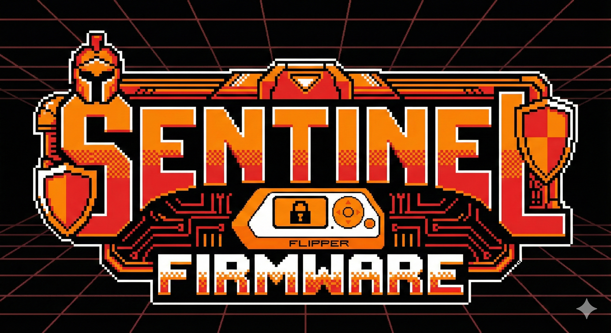

<div align="center">



##### ESPAÑOL // SPANISH #####

# Firmware Sentinel

**Firmware Flipper Zero centrado en la seguridad con scripting avanzado y análisis de señales profesional**

[](https://github.com/alejandropsan/Sentinel-Firmware/actions)
[](https://github.com/alejandropsan/Sentinel-Firmware/blob/dev/LICENSE)
[](https://github.com/alejandropsan/Sentinel-Firmware/releases)

</div>

> **Estado del proyecto: pre-alpha.** Hoy Sentinel es el firmware Momentum con la marca y el asset pack de Sentinel.
> Las funciones de seguridad, scripting y análisis de señales que se describen más abajo están **planificadas, todavía no implementadas**.
> Consulte [ROADMAP.md](ROADMAP.md) para ver el estado de cada una.

## Noticias y Novedades
- **07/12/2025** Comienzo del proyecto: hemos iniciado el fork y la creación del repositorio.
- **08/12/2025** Creación del servidor de Discord: https://discord.gg/eQHHB6SSRU
- **11/2026** Rebrand completo: iconos y animaciones Sentinel, y corrección de un cuelgue al arrancar con el pack Sentinel.

## Filosofía

Sentinel llena el vacío entre la estabilidad y la innovación en el ecosistema Flipper Zero:

- **La seguridad es lo primero**: PIN de coacción, almacenamiento cifrado, registro de auditoría
- **Fácil de usar para los desarrolladores**: DuckyScript 3.0, MicroPython, macros visuales
- **Análisis profesional**: analizador de espectro, decodificador de protocolos, demodulación avanzada
- **Rendimiento estable**: basado en la probada base Momentum

## Disponible hoy

### Heredado de Momentum (basado en mntm-011)
- Sistema Asset Packs para una personalización completa.
- Frecuencias SubGHz ampliadas (281-962 MHz).
- Bad-KB con suplantación de Bluetooth
- 8 estilos de interfaz, incluido CoverFlow
- 183 aplicaciones integradas

### Propio de Sentinel
- Marca Sentinel (`FIRMWARE_ORIGIN = "Sentinel"`)
- Asset pack Sentinel: 3 animaciones (Scanning, Secure, Security) e iconos propios
- Iconos Sentinel en el menú principal y en el menú de bloqueo

## Características planificadas (aún no disponibles)

### Seguridad y privacidad
- **PIN de emergencia**: borrado de emergencia en caso de introducción de un PIN comprometido
- **Almacenamiento cifrado**: cifrado AES-256 para archivos confidenciales
- **Registro de auditoría**: seguimiento completo de las operaciones
- **Cadena de arranque segura**: verificación de la integridad del firmware

### Scripting avanzado
- **DuckyScript 3.0**: variables, condicionales, bucles, funciones
- **MicroPython Runtime**: scripting Python completo en el dispositivo
- **Editor visual de macros**: automatización basada en nodos (aplicación móvil)

### Análisis de señales
- **Analizador de espectro**: visualización en tiempo real con pantalla en cascada
- **Decodificador de protocolos**: análisis automático de protocolos desconocidos.
- **Demodulación avanzada**: compatibilidad con 4FSK, PSK y QAM.
- **Herramientas de exportación**: formatos GNURadio, URH, CSV y WAV.

## Instalación

Todavía no hay versiones publicadas ni instalador web. Por ahora, la única forma de instalar Sentinel es compilarlo desde el código fuente.

### Compilar e instalar por USB

```bash
git clone --recursive https://github.com/alejandropsan/Sentinel-Firmware.git
cd Sentinel-Firmware
./fbt flash_usb_full
```

`flash_usb_full` compila el paquete de actualización completo y lo instala en un Flipper conectado por USB (cierre qFlipper antes).
Para generar solo el paquete, use `./fbt updater_package`, que lo deja en `dist/f7-C/`. Después puede instalarlo con qFlipper («Install from file», archivo `.tgz`).

### Activar el asset pack Sentinel

En el Flipper: **Momentum → Interface → Graphics → Asset Pack → Sentinel**.

### Próximamente
- Versiones publicadas en [Releases](https://github.com/alejandropsan/Sentinel-Firmware/releases)
- Instalador web

## Hoja de ruta

- [x] Fase 0: Fork, marca, CI y asset pack Sentinel
- [ ] Fase 1: Núcleo de seguridad (PIN de coacción, almacenamiento cifrado, registro de auditoría): **siguiente fase, sin empezar**
- [ ] Fase 2: Scripting avanzado (DuckyScript 3.0, MicroPython)
- [ ] Fase 3: Análisis de señales (analizador de espectro, decodificador de protocolos)
- [ ] Fase 4: Comunidad y pulido

Consulte [ROADMAP.md](ROADMAP.md) para ver el detalle de cada fase.

## Contribuciones

Sentinel es de código abierto (GPL-3.0) y agradece las contribuciones.

- **Informes de errores**: [Abrir un problema](https://github.com/alejandropsan/Sentinel-Firmware/issues)
- **Solicitudes de funciones**: [Discusiones](https://github.com/alejandropsan/Sentinel-Firmware/discussions)
- **Solicitudes de incorporación de cambios**: Consulte [CONTRIBUTING.md](CONTRIBUTING.md)

## Créditos

Creado sobre la excelente base del [firmware Momentum](https://github.com/Next-Flip/Momentum-Firmware) de WillyJL y su equipo.

Agradecimientos especiales a:
- El equipo de Momentum por el código base
- El equipo de Unleashed por las implementaciones de protocolo
- Flipper Devices por el increíble hardware
- Toda la comunidad Flipper

## Licencia

Licencia GPL-3.0 - Consulte [LICENSE](LICENSE)

## Enlaces

- **Discord**: https://discord.gg/eQHHB6SSRU
- **Sitio web**: próximamente
- **Documentación**: próximamente

---

**Descargo de responsabilidad**: Úselo de forma responsable y ética. Pruébelo solo en dispositivos que sean de su propiedad o para los que tenga permiso explícito para probarlos.


##### INGLÉS // ENGLISH #####

# Sentinel Firmware

**Security-focused Flipper Zero firmware with advanced scripting and professional signal analysis**

[](https://github.com/alejandropsan/Sentinel-Firmware/actions)
[](https://github.com/alejandropsan/Sentinel-Firmware/blob/dev/LICENSE)
[](https://github.com/alejandropsan/Sentinel-Firmware/releases)

> **Project status: pre-alpha.** Today Sentinel is Momentum firmware with Sentinel branding and asset pack.
> The security, scripting and signal analysis features described below are **planned, not implemented yet**.
> See [ROADMAP.md](ROADMAP.md) for the status of each one.

## News and Updates
- **07/12/2025** Project start: we have begun the fork and created the repository.
- **08/12/2025** Discord server created: https://discord.gg/eQHHB6SSRU
- **11/2026** Full rebrand: Sentinel icons and animations, plus a fix for a boot crash with the Sentinel pack.

## Philosophy

Sentinel fills the gap between stability and innovation in the Flipper Zero ecosystem:

- **Security First**: Duress PIN, encrypted storage, audit logging
- **Developer Friendly**: DuckyScript 3.0, MicroPython, visual macros
- **Professional Analysis**: Spectrum analyzer, protocol decoder, advanced demodulation
- **Stable Performance**: Built on proven Momentum foundation

## Available Today

### Inherited from Momentum (based on mntm-011)
- Asset Packs system for full customization
- Extended SubGHz frequencies (281-962 MHz)
- Bad-KB with Bluetooth spoofing
- 8 interface styles including CoverFlow
- 183 built-in applications

### Sentinel-specific
- Sentinel branding (`FIRMWARE_ORIGIN = "Sentinel"`)
- Sentinel asset pack: 3 animations (Scanning, Secure, Security) and custom icons
- Sentinel icons in the main menu and lock menu

## Planned Features (not available yet)

### Security & Privacy
- **Duress PIN**: Emergency wipe on compromised PIN entry
- **Encrypted Storage**: AES-256 encryption for sensitive files
- **Audit Logging**: Comprehensive operation tracking
- **Secure Boot Chain**: Firmware integrity verification

### Advanced Scripting
- **DuckyScript 3.0**: Variables, conditionals, loops, functions
- **MicroPython Runtime**: Full Python scripting on-device
- **Visual Macro Editor**: Node-based automation (mobile app)

### Signal Analysis
- **Spectrum Analyzer**: Real-time visualization with waterfall display
- **Protocol Decoder**: Automatic analysis of unknown protocols
- **Advanced Demodulation**: 4FSK, PSK, QAM support
- **Export Tools**: GNURadio, URH, CSV, WAV formats

## Installation

There are no published releases or web installer yet. For now, the only way to install Sentinel is to build it from source.

### Build and install over USB

```bash
git clone --recursive https://github.com/alejandropsan/Sentinel-Firmware.git
cd Sentinel-Firmware
./fbt flash_usb_full
```

`flash_usb_full` builds the full update package and installs it on a USB-connected Flipper (close qFlipper first).
To only build the package, use `./fbt updater_package`, which puts it in `dist/f7-C/`. You can then install it with qFlipper ("Install from file", `.tgz` file).

### Enable the Sentinel asset pack

On the Flipper: **Momentum → Interface → Graphics → Asset Pack → Sentinel**.

### Coming soon
- Published versions in [Releases](https://github.com/alejandropsan/Sentinel-Firmware/releases)
- Web installer

## Roadmap

- [x] Phase 0: Fork, branding, CI and Sentinel asset pack
- [ ] Phase 1: Security Core (Duress PIN, Encrypted Storage, Audit Log): **next phase, not started**
- [ ] Phase 2: Advanced Scripting (DuckyScript 3.0, MicroPython)
- [ ] Phase 3: Signal Analysis (Spectrum Analyzer, Protocol Decoder)
- [ ] Phase 4: Community & Polish

See [ROADMAP.md](ROADMAP.md) for details on each phase.

## Contributing

Sentinel is open source (GPL-3.0) and welcomes contributions!

- **Bug Reports**: [Open an issue](https://github.com/alejandropsan/Sentinel-Firmware/issues)
- **Feature Requests**: [Discussions](https://github.com/alejandropsan/Sentinel-Firmware/discussions)
- **Pull Requests**: See [CONTRIBUTING.md](CONTRIBUTING.md)

## Credits

Built on the excellent foundation of [Momentum Firmware](https://github.com/Next-Flip/Momentum-Firmware) by WillyJL and team.

Special thanks to:
- Momentum team for the codebase
- Unleashed team for protocol implementations
- Flipper Devices for the amazing hardware
- The entire Flipper community

## License

GPL-3.0 License - See [LICENSE](LICENSE)

## Links

- **Discord**: https://discord.gg/eQHHB6SSRU
- **Website**: coming soon
- **Documentation**: coming soon

---

**Disclaimer**: Use responsibly and ethically. Only test on devices you own or have explicit permission to test.
